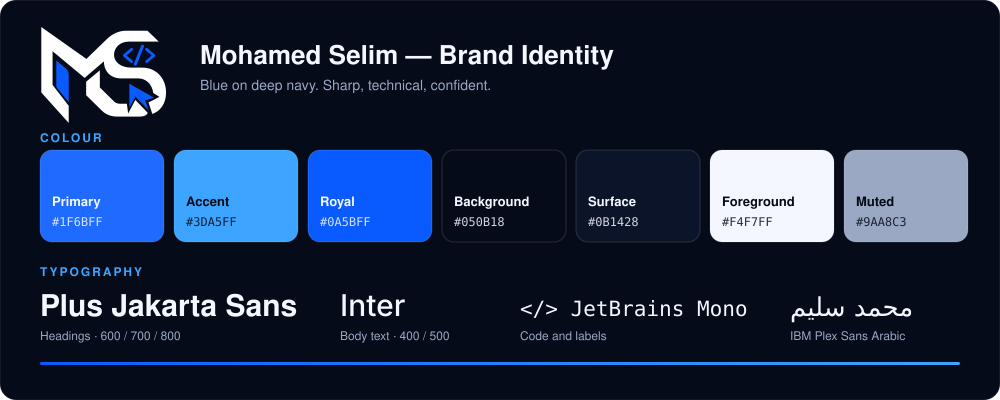

# Mohamed Selim — Brand Identity

A small, practical identity system for everything I publish: this profile, the
[portfolio](https://portfolio.mohamedselim.workers.dev), project READMEs, slides and social media.

**Positioning:** a Full-Stack Developer who ships things that actually work — web and machine learning.
**Personality:** sharp, technical, calm, confident. Never loud.
**Tagline:** *I build things that actually work.*

## Logo

The mark is an **MS** monogram. The `</>` tag stands for code, the cursor for the product people use.

| File | Use on |
|---|---|
| [`logo.svg`](logo.svg) | dark backgrounds (white + blue) |
| [`logo-dark.svg`](logo-dark.svg) | light backgrounds (near-black + blue) |
| [`avatar.png`](avatar.png) / [`avatar.svg`](avatar.svg) | profile picture: GitHub, LinkedIn, Instagram (1000 × 1000) |
| [`favicon.svg`](favicon.svg) / [`favicon-180.png`](favicon-180.png) | browser tab and home-screen icon |
| [`linkedin-banner.png`](linkedin-banner.png) | LinkedIn cover (1584 × 396) |
| [`social-preview.png`](social-preview.png) | repository social preview (1280 × 640) |
| [`business-card-front.png`](business-card-front.png) / [`business-card-back.png`](business-card-back.png) | business card, 3.5 × 2 in at 300 dpi |
| [`email-signature.html`](email-signature.html) | email signature |

- **Clear space:** keep at least the height of the `</>` tag free on every side.
- **Minimum size:** 32 px wide on screen.
- **Don't:** recolour, stretch, rotate, add shadows or place it on busy images.

## Colour

| Role | Hex | Use |
|---|---|---|
| Primary | `#1F6BFF` | buttons, links, key shapes |
| Accent | `#3DA5FF` | highlights, secondary shapes, gradients |
| Royal | `#0A5BFF` | the logo blue |
| Background | `#050B18` | page background |
| Surface | `#0B1428` | cards and panels |
| Foreground | `#F4F7FF` | text on dark |
| Muted | `#9AA8C3` | secondary text |

Gradients run from Royal to Accent. Keep one blue family per layout: no purple, green or orange accents.

## Typography

| Role | Font | Weights |
|---|---|---|
| Headings | Plus Jakarta Sans | 600 / 700 / 800 |
| Body | Inter | 400 / 500 |
| Arabic | IBM Plex Sans Arabic | 400 – 700 |
| Code and labels | JetBrains Mono | 400 / 600 |

## Voice

Short sentences. Concrete over clever. Say what was built and what it does.
English first; Arabic versions use true right-to-left layout.

## Where it is applied

- Profile README: header, footer, badges, charts (`prussian` card theme, blue snake and 3D graph).
- Portfolio site: same palette, fonts and logo (`ms-portfolio`).
- Regenerate every SVG with `python3 scripts/make_brand.py`, then the PNGs with `python3 scripts/render_brand.py`.
